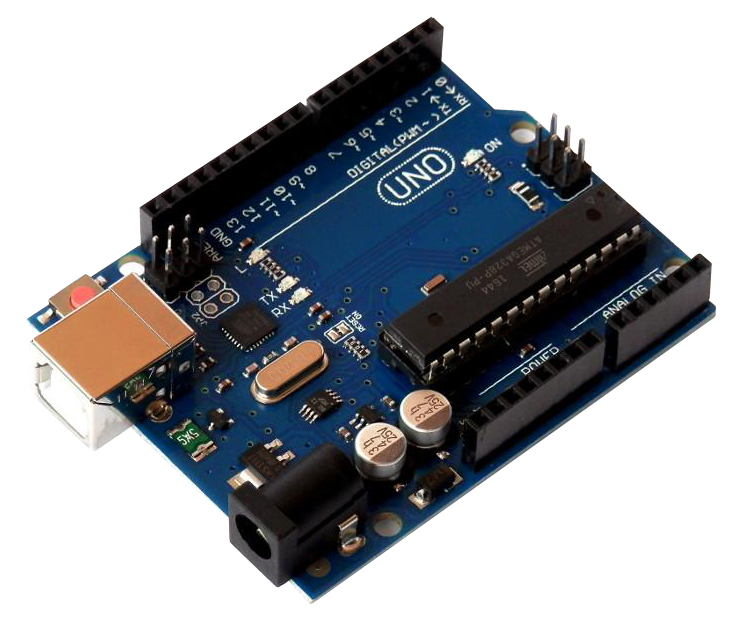
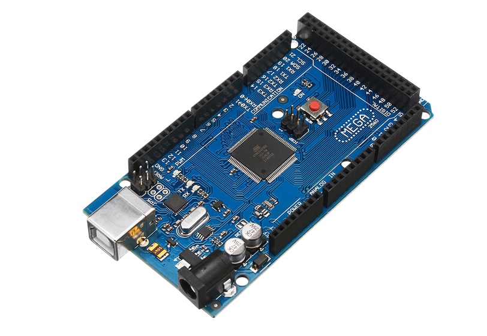
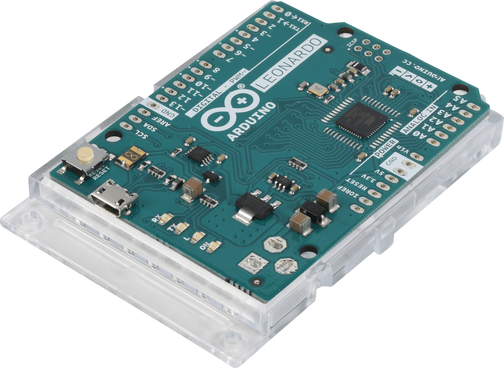

# A0. Conociendo Arduino

## Conociendo Arduino

**¿Qué es Arduino?**

Arduino es una plataforma de creación de electrónica de código abierto, basada en hardware y software libre, flexible y fácil de utilizar por creadores y desarrolladores.

Permite crear diferentes tipos de microordenadores de una sola placa a la que darle diferentes tipos de uso. Al ser de hardware libre, ofrece las bases para que cualquier otra persona o empresa pueda crear sus propias placas, siendo funcionales al partir de la misma base pese a ser distintas entre ellas.

**¿Cuáles son sus características más importantes?**

La principal característica de las placas Arduino es su mera existencia, por ser de hardware y software libre. Además, las placas pueden ser programadas en sistemas Windows y GNU/Linux, e integran los elementos necesarios para conectar periféricos de entrada y salida.

**¿Cuál es el origen de Arduino?**

El proyecto nació en 2003, cuando varios estudiantes del Instituto de Diseño Interactivo de Ivrea (Italia). El objetivo de sus creadores era que los estudiantes de electrónica tuvieran una alternativa más económica a las BASIC Stamp.

**¿Qué modelos de Arduino hay?**

| **Arduino**             | **Uno**                                   | **Mega**                                   | **Leonardo**                              |
| ----------------------- | ----------------------------------------- | ------------------------------------------ | ----------------------------------------- |
| **Microcontrolador**    | ATmega328                                 | ATmega2560                                 | ATmega32u4                                |
| **Voltaje**             | 7-12V                                     | 7-12V                                      | Voltaje entrada: 7-12VVoltaje trabajo: 5V |
| **Pines digitales**     | 14 pines digitales de I/O (6 salidas PWM) | 54 pines digitales de I/O (14 salidas PWM) | 20 pines digitales I/O7 canales PWM       |
| **Entradas analógicas** | 6 entradas                                | 16 entradas                                | 12 entradas                               |
| **Memoria**             | 32k de memoria Flash                      | 256k de memoria Flash                      | 32KB de memoria Flash                     |
| **Reloj**               | 16MHz                                     | 16MHz                                      | 16MHz                                     |
|                         |               |               |          |

**¿Para qué sirve un Arduino?**

La flexibilidad y la accesibilidad que proporciona Arduino posibilita utilizar este tipo de placas para prácticamente cualquier implementación, usadas en multitud de ámbitos: robótica, videojuegos, sistemas audiovisuales, utilidades y herramientas, etc.

**¿Qué lenguaje utiliza?**

El lenguaje más usado en Arduino es C++, aunque también se usan otros en menor medida.

**¿Qué es el Arduino IDE?**

Arduino IDE es el entorno de desarrollo propio de estas placas. Es un software libre y de código abierto diseñado con la finalidad de escribir, compilar y cargar código en las placas. Permite a los usuarios crear programas (sketches) en un lenguaje simplificado basado en C++ para controlar componentes electrónicos, facilitando el desarrollo de proyectos de robótica y automatización.

**Webgrafía**

* ​[https://www.xataka.com/basics/que-arduino-como-funciona-que-puedes-hacer-uno](https://www.xataka.com/basics/que-arduino-como-funciona-que-puedes-hacer-uno)​
* ​[https://arduino.cl/arduino-2/?srsltid=AfmBOorIE-OK7ggcUyYIZL\_dfrbhDx7-mYNDNKppj1NSqYulDeRZ6YaX](https://arduino.cl/arduino-2/?srsltid=AfmBOorIE-OK7ggcUyYIZL_dfrbhDx7-mYNDNKppj1NSqYulDeRZ6YaX)​
* ​[https://nubecolectiva.com/blog/los-5-mejores-lenguajes-de-programacion-para-arduino/](https://nubecolectiva.com/blog/los-5-mejores-lenguajes-de-programacion-para-arduino/)
